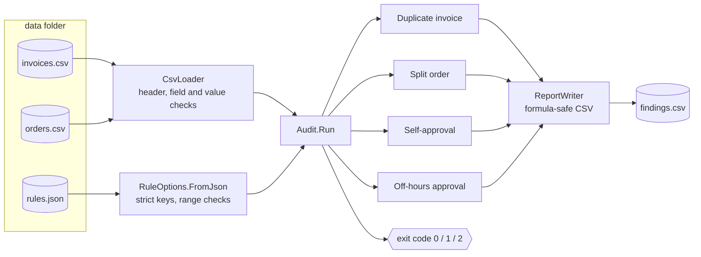

# Payment Anomaly Detector

[](https://github.com/Dogukanyllmaz/payment-anomaly-detector/actions/workflows/ci.yml)
[](https://github.com/Dogukanyllmaz/payment-anomaly-detector/actions/workflows/codeql.yml)

[](LICENSE)

A continuous-auditing tool for procure-to-pay: it reads purchase-order and invoice exports and flags the
transactions an internal auditor should look at first: **duplicate invoices, split purchases, self-approvals and
off-hours approvals**.

Done by hand, these audit tests mean sampling a spreadsheet once a year. Written as code they run over **every**
transaction each time the export is refreshed, and the exit code lets a scheduler or CI pipeline react to the
result. All data in this repository is synthetic.

## Rules

| Rule | Flags | Why it matters |
|---|---|---|
| **Duplicate invoice** | Same supplier, same amount, within `DuplicateWindowDays` (default 7) | The most common cause of overpayment; invoice numbers often differ, so matching on number alone misses it. |
| **Split order** | Two or more orders from the same requester to the same supplier within `SplitWindowDays` (default 3), each below `ApprovalLimit` but together at or above it | A purchase cut into pieces to stay under the approval limit bypasses the higher approval level. Orders already at or above the limit are excluded: they went through that level anyway. |
| **Self-approval** | Requester and approver are the same user | No segregation of duties. |
| **Off-hours approval** | Approved at the weekend or outside `WorkdayStart`–`WorkdayEnd` (default 07:00–20:00) | Approvals given when nobody is likely to review them; also a sign of shared or delegated credentials. |

Each finding names the rule, the documents involved and a reason an auditor can read without opening the data.

## Design



The rules live in a class library (`PaymentAnomalies.Core`) with no I/O beyond the loader and report writer, so the
same rules can run behind a scheduled job, an API or a workflow-platform integration. The command-line app is a
thin shell around it.

## Run

```bash
dotnet run --project src/PaymentAnomalies.Cli
```

```
[Duplicate invoice] INV-004, INV-006: SUP-104 billed 18,450.00 twice, 3 day(s) apart
[Split order] PO-002, PO-003, PO-004: u.kaya placed 3 orders with SUP-202 within 1 day(s), total 102,400, each below the 100,000 limit
[Self-approval] PO-005: a.celik approved their own order
[Off-hours approval] PO-007: Approved by s.arslan on Sat 2026-03-07 11:45
[Off-hours approval] PO-008: Approved by m.demir on Mon 2026-03-09 22:15

Checked 12 invoices and 12 orders: 5 finding(s)
  Duplicate invoice: 1
  Split order: 1
  Self-approval: 1
  Off-hours approval: 2
Report written to findings.csv
```

The sample data also contains look-alikes that must **not** fire: a monthly rent invoice with the same amount
31 days apart, the same supplier billing the same amount three weeks later, and an order above the limit.
An end-to-end test pins the sample to exactly these five findings.

Run it on your own export (paths are relative to the current directory):

```bash
dotnet run --project src/PaymentAnomalies.Cli -- path/to/export path/to/report.csv
```

### Exit codes

| Code | Meaning |
|---|---|
| `0` | No findings; an empty report (header only) is written |
| `1` | Findings written to the report |
| `2` | Error: bad arguments, unreadable or invalid input, invalid `rules.json` or report path. A one-line message goes to stderr and no report is left behind, so a pipeline never reads stale findings. |

Use it as a gate, for example in a nightly job: fail or notify on `1`, alert the owner of the export on `2`.

## Input

| File | Columns | Formats |
|---|---|---|
| `invoices.csv` | `Id,SupplierId,InvoiceNumber,Date,Amount` | date `yyyy-MM-dd` |
| `orders.csv` | `Id,RequesterId,ApproverId,SupplierId,Amount,ApprovedAt` | timestamp `yyyy-MM-ddTHH:mm` |
| `rules.json` | `DuplicateWindowDays`, `SplitWindowDays`, `ApprovalLimit`, `WorkdayStart`, `WorkdayEnd` | all optional; defaults shown above |

- The first line must be the header shown above; a headerless file is rejected instead of losing its first record.
- Fields are plain comma-separated values; quoted fields containing commas are not supported. Every field is required.
- Amounts use a dot as the decimal separator and are compared as plain numbers, in whatever currency the export uses.
- User and supplier codes are matched case-insensitively.
- `rules.json` is strict: an unknown key (a typo such as `SplitWindowDay`), a window outside 0–366 days, a
  non-positive limit or a workday that does not start before it ends stops the run, rather than auditing quietly on
  a default threshold.

## Security

- The report is safe to open in a spreadsheet: values starting with `=`, `+`, `-`, `@` or a tab are prefixed
  with `'`, so a formula smuggled in through the input data cannot run. It is written as UTF-8 with a BOM so
  Turkish and other non-ASCII names display correctly.
- No network access, no credentials, no database. CI runs with read-only permissions; CodeQL scans every push
  and weekly; Dependabot keeps NuGet packages and Actions current.
- See [SECURITY.md](SECURITY.md) to report a vulnerability.

## Known limitations

- Recurring charges with a fixed amount (rent, subscriptions) are flagged if they fall inside the duplicate window.
- Public holidays are treated as working days.
- One approval limit for all orders; real approval matrices usually vary by amount band, department and category.
- Files are read fully into memory, and split-order detection compares orders within each requester–supplier
  window; sized for departmental exports, not for millions of rows in one run.

## Development

```bash
dotnet build      # warnings are errors, .NET analyzers on
dotnet test       # unit + end-to-end tests
dotnet format --verify-no-changes
```

| Path | Purpose |
|---|---|
| `src/PaymentAnomalies.Core/Rules.cs` | The four rules and `Audit.Run` |
| `src/PaymentAnomalies.Core/CsvLoader.cs` | CSV parsing with header, field and line-numbered value checks |
| `src/PaymentAnomalies.Core/Domain.cs` | Invoice, order, finding and threshold records; strict `rules.json` loading |
| `src/PaymentAnomalies.Core/ReportWriter.cs` | Formula-safe CSV report |
| `src/PaymentAnomalies.Cli/App.cs` | Arguments, exit codes and error messages |
| `tests/PaymentAnomalies.Tests` | xUnit tests for every rule, boundary and failure path, plus an end-to-end run on the sample data |

## License

[MIT](LICENSE)
